<div align="center">




# Fiverr Gig Optimizer

**Evidence-backed gig research, pricing, copy, and policy preflight checks.**


</div>

This local-first skill turns your services into a Fiverr Gig catalog with titles,
tags, package pricing, descriptions, image specifications, and a phased launch
plan. Market numbers always come from deterministic scripts and visible data;
the model never invents competition, demand, or competitor pricing.

> This is an independent project and is not affiliated with or endorsed by
> Fiverr International Ltd. Fiverr is a trademark of its respective owner.

## What changed for 2026–2027

- A deterministic policy preflight checks current title, tag, description,
  package, revision, pricing, and image-copy constraints before rendering.
- A weekly GitHub Action hashes the official Fiverr Help Center policy pages.
  When a source changes, it opens a review PR instead of silently changing the
  optimizer's behavior.
- Direct marketplace scraping and automated profile import are no longer part
  of the supported workflow. Fiverr's reviewed Terms prohibit automated
  crawling/scraping, so current counts should be pasted by the user or loaded
  from a dataset the user is allowed to use.
- GitHub Dependabot checks Python and Actions dependencies monthly.
- Generated HTML safely escapes embedded JSON before placing it in a script.

Policy automation is deliberately reviewable: a changed web page does not prove
that a specific operational limit changed. The bot flags the source, then a
maintainer reviews and updates `policy-rules.json` with source-backed values.

## ChatGPT and Codex

The repository now contains a validated OpenAI plugin manifest at
`.codex-plugin/plugin.json`. On supported ChatGPT and Codex plugin surfaces,
import the repository or its ZIP, select **Fiverr Gig Optimizer**, and start with
one of the included prompts. Codex can also use the repository directly:

```bash
codex -C /path/to/fiverr-gig-optimizer
```

See the complete [ChatGPT and Codex setup guide](docs/guides/OPENAI_SETUP.md),
including the fallback for ChatGPT Projects that do not support plugin import.

## GitHub Pages

The animated, responsive project site is a self-contained [`index.html`](index.html)
with no CDN or build step. After pushing the repository, choose **GitHub Actions**
as the Pages source under **Settings → Pages**. The included deployment workflow
publishes the page on pushes to `main`, or it can be run manually.

See the [GitHub Pages deployment guide](docs/guides/GITHUB_PAGES.md).

## Claude Code compatibility

Replace the placeholder with your own GitHub account after publishing the repo:

```text
/plugin marketplace add YOUR_GITHUB_USERNAME/fiverr-gig-optimizer
/plugin install fiverr-gig-optimizer@fiverr-tools
```

The scoring core uses only Python's standard library. Install optional community
dataset support with:

```bash
python -m pip install -r requirements.txt
```

## Data paths

1. **Bundled sample data:** free and deterministic, but partial and dated.
2. **Manual current count:** paste the “services available” count shown in your
   own Fiverr browser session.
3. **User-owned JSON/CSV:** build local pricing pools and an index from data you
   lawfully collected or exported:

```bash
python skills/fiverr-gig-optimizer/scripts/build_benchmarks.py --csv rows.csv
```

No Fiverr email, password, cookie, or private analytics are requested or stored.

## Core commands

```bash
# Look up a keyword in the bundled/local dataset
python skills/fiverr-gig-optimizer/scripts/query_dataset.py --keyword "ai chatbot"

# Score a real count (never guessed)
python skills/fiverr-gig-optimizer/scripts/score_keyword.py --keyword "ai chatbot" --gig-count 240

# Validate a completed catalog against the reviewed policy snapshot
python skills/fiverr-gig-optimizer/scripts/validate_gig.py gig-config.json

# Render only after policy validation passes
python skills/fiverr-gig-optimizer/scripts/build_catalog.py gig-config.json --out fiverr-catalog.html

# Check whether official policy sources changed
python skills/fiverr-gig-optimizer/scripts/sync_policy_sources.py
```

## Current reviewed Fiverr constraints

The machine-readable source of truth is
[`policy-rules.json`](skills/fiverr-gig-optimizer/references/policy-rules.json),
reviewed on **2026-09-30**. Highlights include:

- title starts with “I will,” stays within 80 characters, and avoids discouraged
  special characters;
- 1–5 relevant tags and descriptions up to 1,200 characters;
- up to three packages, at least one revision per package, and a $5 platform
  minimum where a category does not require more;
- recommended Gig image size 1280×769, with no more than 10 words of image text;
- no Fiverr logos, ratings, seller-level badges, contact details, or material
  you do not have permission to use in Gig images.

Rules can change, category-specific requirements can be stricter, and a passing
local check never guarantees platform approval. Always review the linked official
sources before publishing.

## Community dataset

Contribution is opt-in and off by default. Configure your own Hugging Face
dataset URL in `scoring-config.json`, preview the exact anonymized rows, and only
then upload:

```bash
python skills/fiverr-gig-optimizer/scripts/contribute.py --input benchmarks.local.json --dry-run
```

The uploader rebuilds every row from an allow-list and rejects seller-identifying
fields. See the [data policy](docs/governance/DATA_POLICY.md).

## Architecture and project evidence

- [Documentation index](docs/README.md)
- [ChatGPT and Codex setup](docs/guides/OPENAI_SETUP.md)
- [System architecture](docs/architecture/SYSTEM_ARCHITECTURE.md)
- [Catalog wireframe](docs/wireframes/CATALOG_WIREFRAME.md)
- [Policy-review wireframe](docs/wireframes/POLICY_REVIEW_WIREFRAME.md)
- [Testing and coverage](docs/quality/TESTING.md)
- [Reproducible evidence records](records/README.md)

## Ownership and connection

This working copy intentionally has no Git `origin` tied to a previous owner.
After creating your own empty repository, connect it with:

```bash
git remote add origin https://github.com/YOUR_GITHUB_USERNAME/fiverr-gig-optimizer.git
git push -u origin main
```

Also replace `Repository Owner` in `.claude-plugin/*.json`, set your dataset URL
in `scoring-config.json`, and add `HF_TOKEN` only if you choose to use the
community-dataset workflow. Never commit passwords or tokens.

For GitHub's repository Social Preview, upload `assets/og-card.png` under
**Settings → General → Social preview**. The generated catalog also includes
Open Graph and Twitter Card metadata pointing to that asset when hosted.

## Test

```bash
python -m coverage run -m pytest -q
python -m coverage report -m
```

Code is MIT licensed. Data and documentation use CC BY 4.0; see
[`LICENSE-DATA`](LICENSE-DATA).
