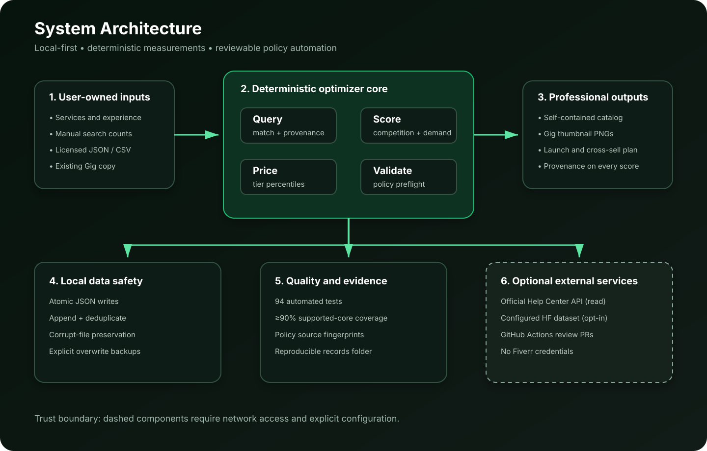

# System Architecture

The optimizer uses a local-first, deterministic pipeline. Human or licensed
data enters through explicit boundaries; no Fiverr credential or session is
required. Market measurements are calculated by scripts, while generative work
is limited to offer design and copy.

## Trust boundaries

1. **User boundary:** service descriptions, manual counts, and lawful JSON/CSV.
2. **Deterministic core:** query, score, price, validate, and render modules.
3. **Local storage:** inputs, derived benchmarks, and generated catalogs.
4. **Optional external boundary:** official policy metadata and an explicitly
   configured Hugging Face community dataset.
5. **CI boundary:** tests, 90% coverage gate, dependency updates, and policy
   source-change review PRs.

## Design principles

- Market numbers always retain provenance.
- Missing data stays missing; it is never filled with an estimate.
- Policy updates require review before changing operational rules.
- External uploads are opt-in, token-gated, and PII-filtered.
- Local writes are atomic and preserve corrupt or replaced inputs.
- Deprecated marketplace-network adapters are excluded from supported runtime
  and from the core coverage metric.
