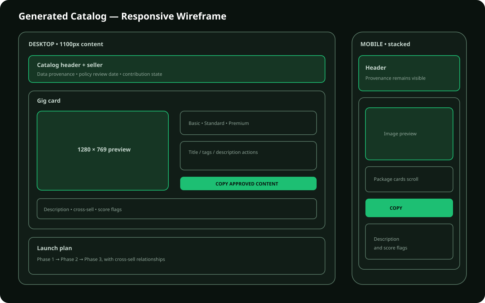

# Catalog Wireframe

The responsive catalog prioritizes provenance and actionable content. Desktop
uses a two-column Gig card; mobile collapses it to one column. Policy review date
and source provenance remain visible above the first result.

Accessibility expectations: semantic headings, readable contrast, keyboard-
reachable controls, text alternatives, and no meaning conveyed by color alone.
