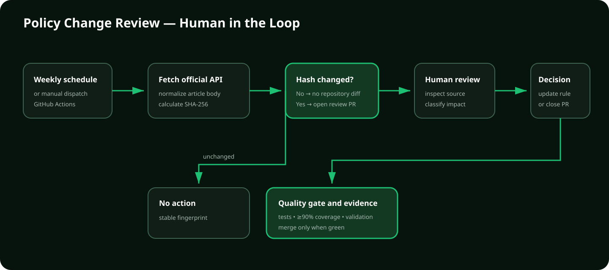

# Policy Review Workflow

The monitor detects source changes but does not automatically reinterpret them.
This human-in-the-loop boundary prevents a Help Center wording or layout change
from silently changing validation behavior.
